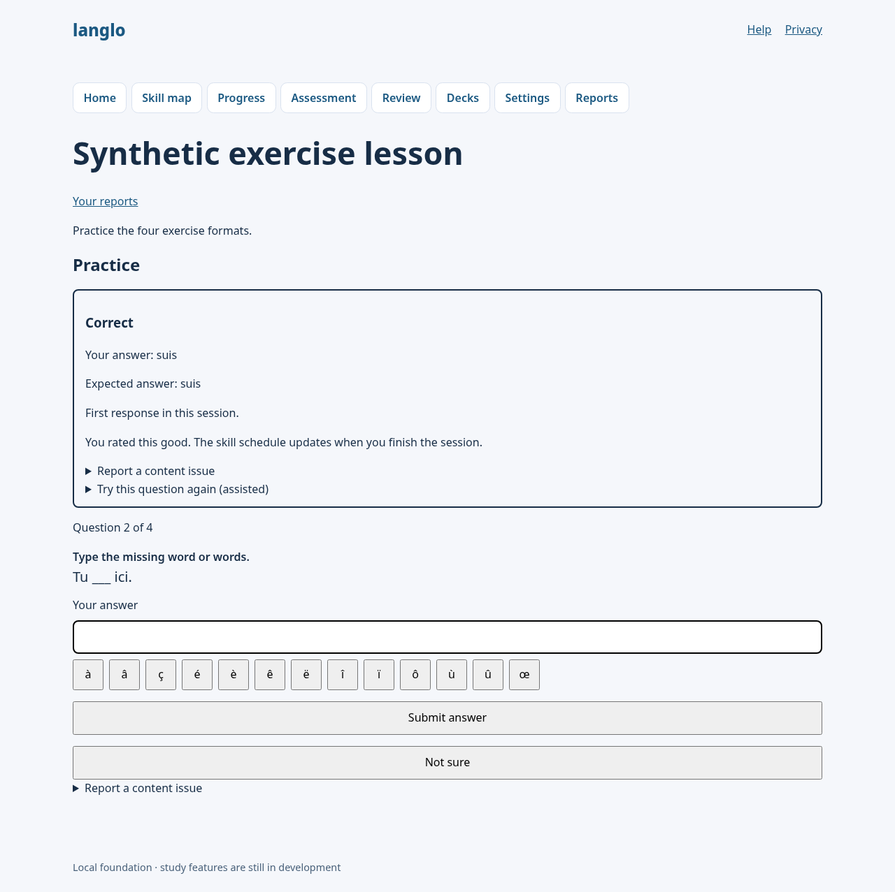

# LANGLO-247 implementation evidence

**Scope:** local grammar-retention pilot implementation using synthetic fixture data. No real learner data, production database, provider calls, paid calls, remote publication, CI secrets, or deployment were used.

## Mastery protection

Grammar FSRS is a separate recall schedule. It cannot mark a skill secure or change grammar-1 mastery status. The existing `scoreGrammar` rule still requires five distinct qualifying items across at least two sessions and at least 80% correct; the first response to a logical item/lineage is the only response that can add mastery evidence. Assisted and unsure responses do not qualify. An unrated correct answer under `grammar-fsrs-1` is treated as never given, so it contributes neither a durable answer/evaluation, mastery evidence, nor a retention event. The schedule only aggregates a completed session's lowest qualifying rating for each skill, at most once per skill/session.

The LANGLO-257 cross-boundary regression reviews the same question in two completed sessions. It observes two FSRS events while mastery remains Practising with only one distinct qualifying item from one evidence session. This demonstrates that retention reviews alone cannot satisfy the mastery floor.

The LANGLO-248 stability comparison was a granularity check, not a mastery safeguard or evidence of delayed grammar recall. It showed that one skill schedule accumulates stability differently from separate schedules for new prompts. The distinction and calibration limits are recorded in [LANGLO-248 evidence](LANGLO-248.md).

## Red/green record

- The focused scheduler behavior test first failed because the grammar-retention module did not exist; it passed after the module and one-event-per-skill/session aggregation were implemented.
- The legacy-session compatibility regression first failed at the new rating gate. The server and UI were then limited to requiring ratings only for sessions tagged `grammar-fsrs-1`; the regression passed and the existing session can continue without a retention rating.
- On the rebased current-main branch, the new regressions first exposed three compatibility failures: a nullable policy marker hid prior legacy answers from exposure checks, and no-verdict fallback markers were being written to practice/legacy attempts. A NULL-safe policy comparison and scoped marker writes fixed them; the focused regression set passed 73/73 and the full suite passed 1,416/1,416.
- After `main` added the five-confirmed-wrong assessment stop, the focused test first showed a retention assessment could keep offering questions after the stop threshold when an earlier correct answer still needed a rating. The assessment now opens its end-stage when the threshold is reached, keeps the session active until every correct answer is rated, and completes when the last rating is saved.
- The browser run exposed a lost `session` query on the rating form action. The action URL now preserves it, and the focused desktop exercise suite passed 4/4.
- Initial refresh checks timed out because the existing build artifact had SvelteKit's version checker compiled as a development no-op. An explicit production-mode build restored the configured checker; the focused desktop refresh checks passed, then the full desktop/mobile E2E suite passed 104/104.
- The rebased E2E run first found that its synthetic practice session was not tagged with the new retention policy, so the test saw legacy feedback with no rating controls. It now seeds the policy explicitly and targets the distinct status messages; the full desktop/mobile suite passed 104/104. The repository's default port 4173 was occupied, so a temporary config ran the built Node server on 4189 and was removed afterward.

## Local validation

- Runtime: Node `v24.19.0`, npm `11.9.0`; `npx --yes npm@11.9.0 ci --ignore-scripts` passed.
- `npx --yes npm@11.9.0 run check`: passed, 0 errors and 0 warnings.
- `npx --yes npm@11.9.0 run lint`: passed.
- `npx --yes npm@11.9.0 run format:check`: passed.
- `npx --yes npm@11.9.0 test`: passed, 91 files and 1,423 tests.
- `npx --yes npm@11.9.0 run test:property`: passed, 5 files and 7 tests.
- `NODE_ENV=production npx --yes npm@11.9.0 run build -- --mode production`: passed with the adapter-node production build.
- `npx --yes npm@11.9.0 run test:e2e -- --config=playwright.validation.config.ts`: passed, 104 tests across desktop and mobile against the built Node server with synthetic fixtures. The temporary config changed only the local server port and was removed after validation.
- `npx --yes npm@11.9.0 exec -- vitest run tests/attempt-fallback.test.ts tests/attempt-evaluation.test.ts tests/assessment-feedback.test.ts tests/assessment.test.ts tests/grammar-retention.integration.test.ts`: passed, 5 files and 73 tests.
- `git diff --check`: passed. Migration `0026` and `0027` are forward-only additions; existing migration SQL, snapshots, and journal entries were not modified.

## Browser evidence

The synthetic desktop screenshot captures the answer, feedback and selected rating before the session is finished:

## Pending acceptance and limits

The synthetic FSRS feasibility comparison does not establish that the schedule predicts delayed grammar recall. LANGLO-253 calibration still needs delayed recall on unseen equivalent questions across skills, tracks, and learner experience, with leakage controls and uncertainty. CI, live provider behavior, production state, learner exposure, and release readiness remain unverified and are not authorized by this local implementation.

## PR #132 review fixes — 2026-10-20

The approved follow-up fixes the two confirmed content-version defects and adds behavior coverage around the reviewed transaction and route boundaries. Grammar mastery, native flashcard behavior, study settings, UI, dependencies and CI policy remain unchanged.

- A frozen grammar review now resolves both its question and lesson from the plan's content version before its first answer. It can finish after a newer version is published; withdrawn content is still refused, and answers from superseded content do not strengthen the current schedule.
- Forward migration `0028_current_grammar_content` replaces the two reset triggers so only the effective newest approved content version can reset schedules. Existing migration SQL, snapshots and journal entries are preserved; the journal only gains the new entry. The upgrade regression preserves existing schedule state, permits repeated migration, and still resets on publication of a genuinely newer version.
- Rating eligibility, owner/session validation, review replay/selection, provisional cleanup, assessment finalization, schedule persistence and event persistence now have focused helpers. Completion, mastery synchronization and retention writes retain their original transaction boundaries and error behavior.
- New tests cover each rating exclusion independently, lowest-rating precedence, simultaneous conflicting/duplicate ratings, repeated finishing, review replay and invalid selections, foreign rating/discard requests, assessment and practice rollback after a synthetic retention-write failure, saved timezone propagation across both DST transitions, and the browser-facing rating/discard/review actions. The long retention integration scenario is split into aggregation/isolation, settings/review and content-reset/history cases.

### Follow-up red/green evidence

- Before the frozen-version fix, the regression expected `fr-a1-001@1:q2` after v2 publication and received `question: null`. The same scenario now passes, including lesson-version matching, answer/rating submission and completion.
- Before the trigger correction, both insertion and promotion of older v2 content rewrote the v3 schedule to v2 and incremented its revision. Both regressions now preserve the v3 schedule unchanged; the existing newer-content reset regression still passes.
- Additional boundary tests verified existing behavior before the refactors: unrated cleanup, owner isolation, duplicate ratings, rollback and timezone propagation already worked. These checks remain green after the refactors.

### Follow-up validation

- Node `24.19.0`, npm `11.9.0`; `npm ci --ignore-scripts`: passed.
- `npm run check`, `npm run lint`, `npm run format:check`: passed.
- `npm test -- --coverage --coverage.reporter=json-summary --coverage.reporter=lcov --coverage.reporter=text --coverage.reportsDirectory=/tmp/langlo-fixes-coverage`: passed, 91 files and 1,465 tests.
- `npm run test:property`: passed, five files and seven tests.
- Local instrumented changed-line coverage against base `6d939eb`: **337/349 (96.56%)**, calculated by intersecting added/modified source lines from `git diff --unified=0 origin/main -- src` with LCOV `DA` entries. The assessment-results rating/discard actions, lesson rating action, practice review action and session action each have 100% of their instrumented changed lines covered. This is a local line-coverage calculation, not a hosted Codecov or branch-coverage result.
- `NODE_ENV=production npm run build -- --mode production`: passed after the final unit suite.
- `npm run test:e2e -- --config=playwright.validation.config.ts`: passed, 104 desktop/mobile tests against the built Node server and synthetic fixtures. The temporary config changed only the local server port to 4189 and was removed after validation.

The first browser launch stopped before running tests because port 4173 was occupied. A subsequent browser run overlapped a unit test that invokes its own build in test mode, replacing the production version checker and invalidating refresh checks. Final browser validation runs after the unit suite and an explicit production-mode build, using a temporary port-4189 config that is removed afterward. No refresh implementation or tests are weakened.

Hosted quality gates, publication of these follow-up changes, delayed-recall calibration, real providers, production migrations and deployment remain separate and unverified by this local evidence.

## Merge with Portuguese platform support — 2026-10-20

The owner confirmed that production is on `main` with `0026_portuguese_tracks` applied, and explicitly approved a one-time exception to resequence the PR's unapplied grammar migrations and reconcile their metadata. Production was not accessed. The merge preserves both commit histories and combines `main`'s B1/B2 and foundation-level reporting with grammar retention's rating stage, provisional-answer rules and five-confirmed-wrong early stop.

| Previous PR migration          | Merged migration               | SQL contents            |
| ------------------------------ | ------------------------------ | ----------------------- |
| `0026_peaceful_albert_cleary`  | `0027_peaceful_albert_cleary`  | Byte-for-byte preserved |
| `0027_sturdy_talkback`         | `0028_sturdy_talkback`         | Byte-for-byte preserved |
| `0028_current_grammar_content` | `0029_current_grammar_content` | Byte-for-byte preserved |

Every migration SQL file and journal entry from `main` through 0026, and its 0026 snapshot, are unchanged. The unapplied PR snapshot chain is reconciled with the Portuguese schema; its journal entries follow 0026 with strictly increasing timestamps. A fixture reproducing the canonical `main` ledger through 0026 is accepted without `LEDGER_DRIFT`, exposes only 0027–0030 as pending, upgrades successfully and retains every existing ledger row.

New forward migration `0030_portuguese_grammar_retention` widens the grammar schedule language constraint to Portuguese. Its table rebuild requires the runner to disable foreign keys before opening the transaction, preserves schedules and events, recreates the guards that reference the rebuilt table, and checks row counts and foreign-key integrity before commit. Tests verify a populated upgrade, repeated migration, preserved append-only guards and owner-deletion behavior, refusal with foreign keys enabled, and rollback after a forced late failure. Only disposable local fixtures were migrated.

### Merge red/green evidence

- The new Portuguese B1/B2 answer/rating regression initially failed with `CHECK constraint failed: grammar_retention_schedules_language`. It now completes the assessment and stores three owner-scoped Portuguese review events.
- The generated SQLite rebuild initially failed because `grammar_retention_events_no_delete` referenced the schedule table during its replacement. The final forward migration removes and restores the three affected guards inside the same transaction; populated-history and rollback regressions pass.
- The existing Portuguese migration preservation test is isolated to its intended 0026 boundary. The local-client remote-apply-path test now expects the complete merged pending suffix and preserves all study-history row counts.
- Focused post-resolution tests: 49 passed across migration, Portuguese-track and ledger-compatibility suites; grammar integration regressions also passed in the first compatibility run.

### Merge validation

- `npm ci --ignore-scripts`: passed on Node 24.19.0 / npm 11.9.0.
- `npm run check`, `npm run lint` and `npm run format:check`: passed; formatting and diff checks were repeated after the evidence update.
- `npm test`: passed, 95 files and 1,517 tests.
- `npm run test:property`: passed, five files and seven tests.
- `NODE_ENV=production npm run build -- --mode production`: passed after the final unit suite.
- `npm run test:e2e -- --config=playwright.validation.config.ts`: passed, 104 desktop/mobile tests against the production build with synthetic fixtures. The temporary config used local port 4189 and was removed afterward.

No production ledger was edited, no production migration was run, and no existing commit was rewritten. Hosted CI and deployment remain separate acceptance gates.
