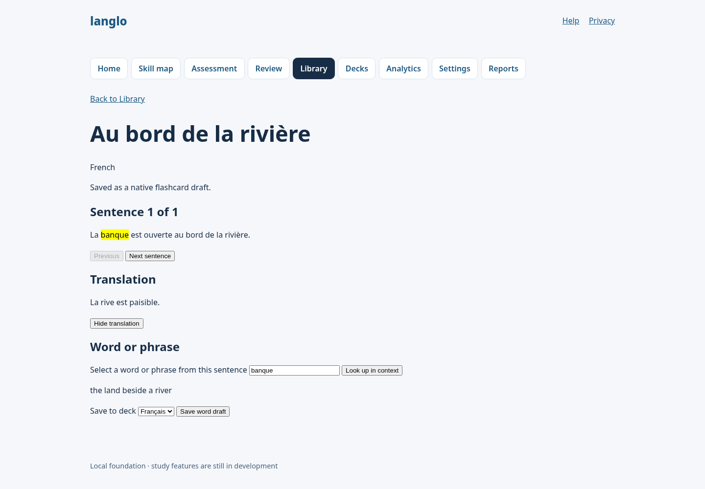

# LANGLO-284: private document Library

Local implementation evidence captured on 2026-10-24 with Node 24.19.0 and
npm 11.9.0. The Library adds owner-scoped TXT, text-PDF, DOCX and EPUB uploads,
sentence reading, saved progress, rename/delete, optional translation and
contextual vocabulary lookup. Extracted text is stored; the uploaded binary is
not retained. Saved vocabulary uses the existing native flashcard draft flow.

## Behavior and data boundaries

- Uploads are limited to 10 MiB and extracted content to 1,000,000 characters.
  At most two office parser workers run at once; OCR and remote asset loading
  are off.
- Scanned PDFs with no extracted text and unsupported/unreadable files are
  rejected. The source language is required at upload.
- Document operations, vocabulary lookups and saved terms are scoped to the
  signed-in owner. Account deletion cascades to Library rows.
- Translation and lookup use only the configured OpenAI GPT-6 Luna model with
  low reasoning, `store: false`, and user-requested calls. Lookup sends the
  selected term and current/neighbor sentences; no provider fallback is used.
- AI context is capped at 16,000 serialized characters, with a persistent
  budget of 100 calls per learner and 1,000 total calls per UTC day. Calls are
  reserved before contacting OpenAI, so failed provider attempts count.
- Compose's 11 MiB adapter ceiling supports Library uploads. A bounded body
  reader rejects oversized requests before framework dispatch, limiting other
  routes and auth proxy requests to 512 KiB even without `Content-Length`.
- Target language follows the matching enrollment's explanation language,
  otherwise the first enrollment, otherwise English. TTS remains out of scope
  for this issue.

## Observed RED and GREEN

- Document parser tests initially failed because supported PDF/DOCX/EPUB
  extraction was missing and an image-only PDF was accepted as text. After the
  bounded parser worker and validation were added, `tests/library-documents.test.ts`
  passed 7 tests.
- Persistence tests initially failed because `createLibraryDocument` was
  absent. After adding the owner-scoped service and forward migration, its
  focused suite passed.
- The sentence/highlight test initially failed because
  `src/lib/library-text.ts` did not exist. After adding segmentation and
  whole-word/phrase matching, its tests passed; saved terms are queried without
  an arbitrary result cap.
- Config/AI tests initially failed because private OpenAI configuration and
  the AI service were absent. After implementation, mocked provider tests
  passed without a live provider call.
- API route tests initially failed because Library endpoints were absent. The
  new API routes and owner-scope tests passed against disposable fixtures.
- The AI budget and context-ceiling tests initially failed because the usage
  table and validation were absent; the concurrent-reservation tests and
  mocked provider checks now pass. The database migration is forward-only.
- The first body guard checked only `Content-Length`. Review identified a
  chunked-request gap; byte-counting stream tests were added, then passed for
  public signup and auth proxy requests without that header.

## Local checks

- `npm ci --ignore-scripts`: completed using the required npm version.
- `npm run check`: passed, 0 errors and 0 warnings after the final code changes.
- `npm run lint`: passed after the final code changes.
- Focused Library/config/migration/body-boundary tests: 12 files and 95 tests
  passed.
- `npm test`: 123 files and 1,947 tests passed.
- `npm run test:property`: 6 files and 9 tests passed.
- `npm run build`: passed.
- `npm run test:e2e`: 150 passed (desktop and mobile), including the Library
  upload/read/resume/rename/delete journey and auth body boundaries.
- Prettier passed for every changed supported file. Repository-wide
  `npm run format:check` reports only the globally ignored local file
  `.claude/settings.local.json`; that file was left untouched.
- `git diff --check`: passed.

`npm audit --omit=dev` reports two production advisories already present at the
starting commit: high severity in `zod@4.6.5` and moderate severity in
`nodemailer@10.0.13`. Dependency changes here add `officeparser`; unrelated
advisories were not changed.

## Pending acceptance

No live OpenAI request, production database validation, or deployment was
performed. The branch and PR are published; CI and hosted acceptance results
have not been verified here. The AI provider path is unit-tested with mocked
fetch only. Local browser results use synthetic fixtures and do not establish
production behavior.

## Review remediation

The adversarial and deeper code reviews were addressed locally:

- Sentence words are keyboard-accessible lookup buttons. The phrase field
  remains available, and saved words stay clickable inside highlights.
- The word and deck controls are disabled while requests are pending. Saving
  captures the submitted term before awaiting the response.
- Vocabulary identity includes the selected deck, and concurrent duplicate
  saves return the winning note. Hashing the structured identity also fixes a
  newly observed crash at the advertised 4,096-character definition limit.
- An existing card that was manually moved, edited, or untagged produces a
  clear conflict instead of a false save confirmation. Its content, placement,
  and review history are preserved.
- PDFs disguised as TXT are rejected rather than displayed as raw PDF syntax.
- Request limits run before SvelteKit or auth parsers can swallow size errors.
  The reader leaves cancellation to the adapter after the response: cancelling
  the input stream immediately was observed to reset the socket before 413.
- A failed progress save preserves the current translation, definition, and
  selected phrase. These are cleared only after successful navigation.

### Observed regression output

Commands used Node 24.19.0 and npm 11.9.0 (the latter through
`node /tmp/langlo-npm-11.9.0/node_modules/npm/bin/npm-cli.js`). These excerpts
record new regression runs; they do not reconstruct the original implementation
logs summarized above.

Initial regression command:

```text
npm test -- tests/library.test.ts tests/library-documents.test.ts tests/signup-boundary.test.ts

FAIL rejects text.pdf disguised as TXT
AssertionError: promise resolved "{ title: 'book', language: 'en', …(1) }" instead of rejecting
FAIL rejects scanned.pdf disguised as TXT
FAIL saves the same vocabulary to the selected deck
FAIL returns the same note for concurrent duplicate saves
LibsqlError: SQLITE_CONSTRAINT: UNIQUE constraint failed: native_flashcard_notes.owner_id, native_flashcard_notes.source_id
FAIL accepts a definition at the advertised length limit
Error: Invalid card identity: all fields must be nonempty bounded strings
FAIL bounds chunked auth API requests when Content-Length is absent
AssertionError: expected 500 to be 413 // Object.is equality
FAIL bounds chunked public form bodies without Content-Length
AssertionError: expected 500 to be 413 // Object.is equality
Test Files  3 failed (3)
Tests  7 failed | 17 passed (24)
```

After the service fixes:

```text
npm test -- tests/library.test.ts tests/library-documents.test.ts tests/signup-boundary.test.ts tests/request-body.test.ts
Test Files  4 passed (4)
Tests  26 passed (26)
```

Reader regressions against the original built server:

```text
playwright test tests/e2e/library.spec.ts --project=desktop -g 'clicks words.*fr|keeps the selected word'
waiting for getByRole('button', { name: 'Look up maison', exact: true })
Test timeout of 20000ms exceeded.
expect(locator).toBeDisabled() failed
Locator: getByLabel('Select a word or phrase from this sentence')
Expected: disabled
Received: enabled
2 failed
```

The expanded browser run then caught two further failures:

```text
keeps phrase study results when progress saving fails and highlights in another document
expect(locator).toBeVisible() failed
Locator: getByText('little house', { exact: true })
Error: element(s) not found

returns 413 for chunked JSON and form requests through the real server
Error: read ECONNRESET
```

The expanded browser fixture reuses a synthetic login session to stay within
the real auth rate limit. Its OpenAI key is explicitly empty; translation and
definition UI responses are intercepted in Playwright. Saving and reading native
notes, upload parsing, progress, and HTTP body limits use the real built server
and disposable fixture database.

Final focused browser result:

```text
playwright test tests/e2e/library.spec.ts
20 passed (17.3s)
```

Further native-card editing regressions:

```text
vitest run tests/library.test.ts
FAIL reports a moved card instead of claiming an unchanged vocabulary save
FAIL reports a edited card instead of claiming an unchanged vocabulary save
FAIL reports a untagged card instead of claiming an unchanged vocabulary save
AssertionError: promise resolved "{ …(2) }" instead of rejecting
Tests  3 failed | 5 passed (8)

vitest run tests/library.test.ts tests/library-routes.test.ts
Test Files  2 passed (2)
Tests  12 passed (12)
```

### Final validation after remediation

```text
npm ci --ignore-scripts --offline
added 593 packages, and audited 594 packages in 4s

npm run check
svelte-check found 0 errors and 0 warnings

npm run lint
exit 0

npm test
Test Files  123 passed (123)
Tests  1955 passed (1955)

npm run test:property
Test Files  6 passed (6)
Tests  9 passed (9)

npm run build
Using @sveltejs/adapter-node
✔ done

npm run test:e2e
168 passed (2.5m)

prettier --check <all changed supported files>
All matched files use Prettier code style!

git diff --check
exit 0
```

The initial sandboxed full unit run hit `spawnSync ... EPERM` and loopback
`listen EPERM`; the permitted local rerun above passed. An initial full browser
run passed 167/168 tests and failed the existing map-navigation timer assertion
in `exercises.spec.ts`. The final full rerun, without the concurrent unit
workload, passed all 168; no map implementation or timer assertion was changed.
The first failure remains evidence of timing sensitivity, not a confirmed
Library defect.

Repository-wide `npm run format:check` still reports only the pre-existing,
globally ignored `.claude/settings.local.json`. All changed supported files
pass. The final review found no further significant defect in the revised
paths. Live OpenAI quality, remote database concurrency, CI, and deployment
remain unverified; there were no live provider calls.

## Post-rebase PR validation

The feature branch was rebased onto `origin/main` at `7829ddb` and validated on
`62c383a2424f96c028e8787c184bd228a42ddc3d` with Node 24.19.0 and npm 11.9.0:

- `npm run check`: passed with 0 errors and 0 warnings.
- `npm run lint`: passed.
- `npm test`: 125 files and 1,972 tests passed.
- `npm run test:property`: 6 files and 9 tests passed.
- `npm run build`: passed.
- Changed supported files pass Prettier. Repository-wide `npm run format:check`
  still reports only the ignored local `.claude/settings.local.json`.
- `npm run test:e2e`: 169 passed, 1 failed. The failure is the existing
  `tests/e2e/exercises.spec.ts:749` map timer assertion (`mapTimerPending` was
  still true after leaving the map). The same test failed when run alone. No
  map implementation or exercise-test code was changed in this branch; the
  shared app layout change adds the Library navigation link. All Library E2E
  cases passed in the full run. Earlier full runs of this suite have both
  passed and failed this timer assertion, so its status remains unresolved.

The reader capture below was taken with a synthetic document and mocked AI
responses; it contains no learner data or live provider output.



No CI result, hosted acceptance, production database validation, or deployment
is claimed here.

## PR review fixes (2026-10-24)

After triage of PR #177 at `b4ae0d4`, three confirmed defects were fixed:

- Document creation, rename, progress updates, and deletion now use the existing
  `executeWrite` connection queue. Four disposable-database regressions hold an
  open transaction, verify the operation waits, then verify its persisted result
  after the transaction commits.
- Every worker exit rejects a still-pending parse promise, including a clean
  exit without a result. An earlier result has already settled the promise, so
  normal message-then-termination behavior is preserved. Tests cover exit codes
  0 and 1 without a message, worker errors, timeouts, and reuse of both parser
  slots after failure.
- TXT content above 1,000,000 normalized characters now produces
  `LIBRARY_CONTENT_TOO_LARGE`, matching office-document extraction and its HTTP
  413 mapping. Tests cover the exact and over-limit text/upload boundaries.

Additional API regressions cover invalid study actions, indices and terms,
unavailable AI configuration without quota consumption, and owner-scoped
PATCH/DELETE persistence and errors. These tests use disposable databases and
synthetic inputs. No live AI provider was called.

Observed RED before the service fixes:

```text
npm test -- tests/library.test.ts tests/library-documents.test.ts tests/library-parser-concurrency.test.ts
FAIL queues a Library create behind an open transaction
FAIL queues a Library rename behind an open transaction
FAIL queues a Library progress behind an open transaction
FAIL queues a Library delete behind an open transaction
AssertionError: expected true to be false
FAIL rejects worker exit 0 without a result
AssertionError: expected undefined to match object { code: 'INVALID_LIBRARY_DOCUMENT' }
FAIL accepts the text ceiling and reports oversized TXT as too much content
Expected: LIBRARY_CONTENT_TOO_LARGE
Received: INVALID_LIBRARY_DOCUMENT
Test Files  3 failed (3)
Tests  6 failed | 22 passed (28)
```

The same three files passed all 28 tests after the service fixes. Final local
validation used Node 24.19.0 and npm 11.9.0:

```text
npm ci --ignore-scripts --offline (npm_config_cache=/tmp/langlo-npm-cache)
added 593 packages
npm run check
svelte-check found 0 errors and 0 warnings
npm run lint
exit 0
npm test
Test Files  125 passed (125)
Tests  1991 passed (1991)
npm run test:property
Test Files  6 passed (6)
Tests  9 passed (9)
npm test -- tests/library-parser-concurrency.test.ts
Test Files  1 passed (1)
Tests  5 passed (5)
npm run build
Using @sveltejs/adapter-node
done
npm run test:e2e
1 failed, 169 passed (2.3m)
```

The final parser-only run followed strengthening the worker-error regression
to verify both slots become reusable. The remaining browser failure is the
previously reported map timer assertion in `tests/e2e/exercises.spec.ts:787`,
this time on desktop: `mapTimerPending` was true after leaving the map. All
Library browser cases passed. This run does not establish a clean E2E suite,
and neither the map implementation nor its assertion was changed.

Repository-wide formatting still reports only the pre-existing ignored
`.claude/settings.local.json`; changed supported files pass Prettier.
The other metric-only refactors and analyzer false-positive adjudication from
triage remain separate from these correctness fixes. Hosted gates, production
database behavior, and deployment remain unverified.

## RewardGuard migration and limit follow-up (2026-10-24)

The Compose and example-environment settings now explain that the 11 MiB
adapter ceiling accommodates 10 MiB files plus multipart overhead. The existing
hook still limits ordinary routes to 512 KiB, and the parser still enforces
the 10 MiB per-file cap. No limit value or runtime implementation changed in
this follow-up.

The legacy-schema comparison excludes objects added after its starting
migration. A cross-reference now points to `tests/library-migrations.test.ts`,
which independently checks the Library additions using literal expectations:

- A disposable database through 0036 has no Library indexes or triggers and
  reports exactly 0037 and 0038 pending, in that order.
- Upgrading creates `library_documents_owner_created` on `(owner_id,
created_at)`, the documents primary-key index on `(id)`, and the usage
  primary-key index on `(day, owner_id)`.
- All three indexes have the expected owning table and uniqueness. No Library
  triggers are created.
- Running migration again preserves the same object names, tables, and SQL
  definitions.

To verify the regression detects a bad definition, the RED run deliberately
reversed `(owner_id, created_at)` in the disposable fixture after migration.
That temporary fixture-only mutation was removed before the GREEN run. No
migration SQL, journal entry, or snapshot was modified.

```text
npm test -- tests/library-migrations.test.ts
FAIL creates the Library indexes on upgrade and preserves their definitions on rerun
Expected: ['owner_id', 'created_at']
Received: ['created_at', 'owner_id']
Test Files  1 failed (1)
Tests  1 failed (1)

npm test -- tests/library-migrations.test.ts tests/db-migrations.test.ts tests/portuguese-migration.test.ts
Test Files  3 passed (3)
Tests  31 passed (31)
```

The full unit suite then passed 126 files and 1,992 tests. Type checking found
0 errors and 0 warnings, lint and build passed, and the separate property run passed all
9 tests. Changed supported files pass Prettier. No new browser run was needed
for this test/comment-only follow-up; the preceding 169-pass/1-failure result
and unresolved map timer assertion remain the latest browser evidence.

## Reject incomplete AI responses (2026-10-24)

The response parser now requires `status: 'completed'` before extracting any
text. Incomplete, failed, or missing-status payloads use the existing
`LIBRARY_AI_UNAVAILABLE` error, so partial text is not returned as a successful
translation or vocabulary definition. The provider budget remains 300 output
tokens, with no retry or fallback. The API regression confirms the failed
provider attempt consumes exactly one quota reservation.

Before the fix, six new regressions failed against `9a8ba17`: token-limited
translation and lookup, content-filtered output, failed output, missing status,
and the API returning HTTP 200 with partial text instead of HTTP 503. Successful
mock responses now include the actual completed status in their fixtures.

```text
npm test -- tests/library-ai.test.ts tests/library-routes.test.ts
FAIL rejects token-limited partial translate output without retrying
FAIL rejects token-limited partial lookup output without retrying
FAIL rejects content-filtered responses even when they contain text
FAIL rejects failed responses even when they contain text
FAIL rejects missing completion status responses even when they contain text
AssertionError: promise resolved partial text instead of rejecting
FAIL returns unavailable instead of partial AI text and counts the provider attempt once
Expected status: 503
Received status: 200
Test Files  2 failed (2)
Tests  6 failed | 16 passed (22)

After the completion-status guard:
Test Files  2 passed (2)
Tests  22 passed (22)

npm test
Test Files  126 passed (126)
Tests  1998 passed (1998)
```

Type checking reports 0 errors and 0 warnings, and lint passes. All provider
responses in these tests are synthetic; no live OpenAI request was made.

The separate property suite passed all 9 tests, the build passed, and the full
desktop/mobile browser run passed all 170 tests (0 failures, skips, or retries).
The prior map timer failure did not recur in this run; its implementation and
assertion were not changed. Changed supported files pass Prettier, while the
repository-wide format check still flags only the pre-existing ignored local
`.claude/settings.local.json`.

## Upload limit follow-up (2026-10-24)

The earlier sections describe a 10 MiB file limit and a 1,000,000-character
content ceiling. Both were changed on request:

- The file limit is 10 MB (10,000,000 bytes) and is checked in the browser
  before upload and again on the server (`LIBRARY_FILE_TOO_LARGE`, HTTP 413).
  The shared message is "Choose a file of 10 MB or smaller." and a file of
  exactly 10,000,000 bytes is accepted.
- There is no limit on extracted text length, so the parser worker no longer
  returns `LIBRARY_CONTENT_TOO_LARGE`. Only the file size is bounded; the
  adversarial review and RewardGuard flag the missing text bound and remain
  open by decision.
- An oversized file shows its message on the Library page without leaving it.
  The message clears when another file is chosen or a rename or delete is
  submitted, so those forms can show their own errors.

Observed results are recorded below.

Red then green, observed 2026-10-24 (only the new and edited tests were run;
the full suite is left to CI):

- `tests/library-routes.test.ts` "answers an oversized file with a 413 that
  accepts exactly 10 MB" failed against the previous message ("Choose a file
  smaller than 10 MB.") and passes with the shared message. Together with
  `tests/library-documents.test.ts`: 26 passed.
- `tests/e2e/library.spec.ts` size-error, clears-on-file-change and
  rename-error-after-oversize cases: 6 passed (desktop and mobile) against a
  fresh build. The first run failed on the old message because the browser
  tests use the built app.

## Original-file reader (2026-10-24)

The Library reader now shows the uploaded PDF, DOCX or EPUB itself as pages
(TXT is paginated plain text) instead of one extracted sentence at a time. The
statement above that the uploaded binary is not retained no longer holds: the
original bytes are now stored with the document.

- Migration `0039_medical_maria_hill` adds `library_document_files` (one row per
  document, format `pdf`, `docx` or `epub`, a `data` blob checked to 1–10,000,000
  bytes, cascade delete with the document) and `library_documents.progress_location`.
  No existing migration, snapshot or journal entry was changed.
- `GET /app/api/library/{id}/file` returns the bytes to the owner only (404 for
  anyone else), as `application/octet-stream` with `nosniff` and a `sandbox` CSP.
- Reading position is saved as `{location, fraction}`; `progress_index` is derived
  from the fraction so the document list keeps showing "Progress: N%".
- Rendering is client-side: pdfjs-dist 6.4.299 (canvas plus text layer), docx-preview
  0.4.1 (links removed) and epubjs 0.3.93 (sandboxed frame, scripts off).
  epubjs was last released in 2023; this is recorded as an accepted risk.
- Selecting a word (click) or phrase (drag, or press-and-hold on touch) opens a
  lookup panel near the selection on desktop and a bottom bar on narrow or touch
  screens. One call returns a translation and an explanation; a separate button
  translates the whole sentence. Saved words are highlighted in the reader.
- Image-only PDFs are still rejected with the existing message; LANGLO-286 tracks
  supporting them.

Observed on the rebuilt app after PR 180 merged (only the Library tests were run;
the full suite is left to CI):

- Unit: `library`, `library-routes`, `library-ai`, `library-text`,
  `library-documents`, `library-parser-concurrency`, `library-migrations`,
  `db-migrations` and `portuguese-migration`: 107 passed.
- E2E (`library.spec.ts`, `owner-routes.spec.ts`, desktop and mobile): 42 tests,
  covering TXT paging and resume, per-language word click, phrase drag, the touch
  bottom bar, PDF, DOCX and EPUB rendering, a failed position save, the 413
  cases, and the owner-only file route. A first run had 2 failures in the rename
  error test because earlier tests leave documents behind; the test no longer
  asserts an empty list and then passed on both projects.
- `svelte-check` 0 errors and 0 warnings; ESLint and Prettier clean.

Pending: red output before implementation was not captured for every reader case;
real-device touch behavior, large books, and live OpenAI lookups are unverified.
